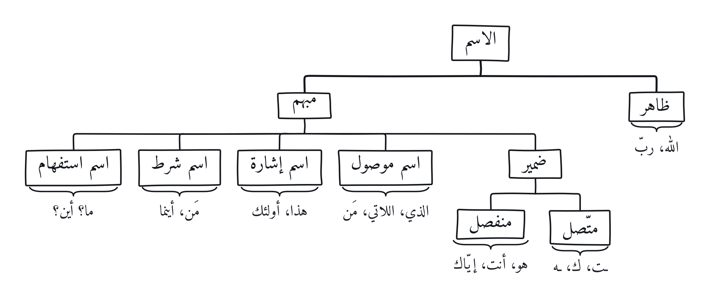

<div align="center">


# مُشَجِّر (Mushajjir)

**محرر مخططات وتشجير تعليمي عربي خفيف مبني بتقنيات GTK4 و Cairo و Pango**  
*A lightweight Arabic educational tree and diagram editor for Linux desktops.*

[](https://www.python.org/)
[](https://www.gtk.org/)
[](https://www.cairographics.org/)
[](LICENSE)

</div>

---

## نبذة عن المشروع / Overview

**مُشَجِّر** أداة متخصصة لصناعة المخططات الشجرية التعليمية (مثل تشجير النحو والصرف، أصول الفقه، مصطلح الحديث، الخرائط المفاهيمية وشجر النسب) على بيئة لينكس. تم تصميم البرنامج لتقديم دعم كامل للكتابة العربية من اليمين إلى اليسار (RTL)، مع معالجة دقيقة للتشكيل عبر HarfBuzz و Pango، وإمكانية إضافة الأقواس الحاصرة الكلاسيكية.

---

## معاينة / Preview

<div align="center">
  
</div>

---

## أبرز الخصائص والمميزات / Key Features

- **دعم متكامل للعربية والتشكيل (Native Arabic RTL & Tashkeel)**:
  - معالجة النصوص عبر مكتبتي Pango و HarfBuzz لضمان رسم الحركات والتشكيل والحروف المتصلة بدقة متناهية.
  - كشف تلقائي لأفضل الخطوط العربية المثبتة على النظام (مثل Amiri, Scheherazade New, Noto Naskh Arabic, Vazirmatn).

- **الأقواس الحاصرة (Curly Braces)**:
  - دعم أصيل للأقواس الحاصرة التعليمية المستخدمة لحصر الأمثلة والتعليقات والفوائد تحت الصناديق أو بجانبها.

- **تشجير ثنائي الاتجاه (Bidirectional Branching)**:
  - إمكانية تفريع العقد في كلا الاتجاهين من نفس الصندوق:
    - رأسي: من الأعلى والأسفل.
    - أفقي: من اليمين واليسار.

- **تعدد الأسطر (Multi-line Support)**:
  - إمكانية كتابة نصوص متعددة الأسطر داخل الصناديق أو في نصوص الأقواس الحاصرة عبر زر الإدخال (Enter).

- **تخطيط ذكي مع حرية السحب والإفلات (Hybrid Layout & Free Positioning)**:
  - خوارزمية ترتيب تلقائي ذكية لتوزيع العقد بانتظام.
  - خطوط إرشادية مغناطيسية (Magnetic Snap Guides) لمحاذاة الصناديق بدقة عند التحريك اليدوي.
  - توجيه تلقائي ذكي لخطوط الربط عند سحب صندوق فوق مستواه أو تحته.

- **نمطان للرسم (Dual Rendering Styles)**:
  - **يدوي (Sketchy)**: يحاكي الرسم اليدوي الطبيعي بخطوط حرة دافئة.
  - **هندسي (Clean)**: خطوط هندسية منتظمة تناسب المطبوعات والكتب الرسمية.

- **أشكال وصناديق حرة وروابط تشابك**:
  - خيارات متنوعة لشكل الصندوق: مستطيل، مستطيل مدور الزوايا، إطار متقطع، أو بدون إطار.
  - لوحة ألوان أكاديمية هادئة مخصصة لخلفيات الصناديق.
  - إمكانية إضافة صناديق عائمة مستقلة وروابط مخصصة بين أي عقدتين.

- **تصدير رسومي فائق الدقة (Crisp Vector & Raster Export)**:
  - تصدير مباشر إلى صيغ SVG و PDF و PNG بدقة عالية (High-DPI).
  - إمكانية اختيار لون الخلفية: ورقي أبيض، شفاف، أو داكن.

- **توافق كامل مع لوحة المفاتيح العربية**:
  - اختصارات لوحة المفاتيح تعمل بسلاسة حتى عند استخدام تخطيط لوحة المفاتيح العربي دون الحاجة للتحويل للإنجليزية.

- **تكامل سلس مع واجهة جنوم (GNOME Integration & CLI)**:
  - واجهة حديثة GTK4 تدعم النمط الداكن وفصل لوحة التحكم الجانبية (`F9`).
  - دعم التثبيت المباشر في قائمة التطبيقات عبر `--install-desktop`.
  - إمكانية التصدير التلقائي بدون واجهة رسومية من الطرفية (CLI Mode).

---

## متطلبات التشغيل / System Requirements

يتطلب البرنامج بايثون 3 مع مكتبات GTK4 و Cairo و Pango:

### Void Linux
```bash
doas xbps-install -S python3 python3-gobject python3-cairo gtk4 pango
```

### Arch Linux / Manjaro
```bash
sudo pacman -S python python-gobject python-cairo gtk4 pango
```

### Debian / Ubuntu / Linux Mint
```bash
sudo apt install python3 python3-gi python3-cairo gir1.2-gtk-4.0 gir1.2-pango-1.0
```

### Fedora
```bash
sudo dnf install python3 python3-gobject python3-cairo gtk4 pango
```

---

## طريقة الاستخدام / Usage

### التشغيل بالواجهة الرسومية:
```bash
python3 mushajjir.py
```
أو لفتح ملف مخطط محفوظ:
```bash
python3 mushajjir.py diagram.msh
```

### التثبيت في قائمة برامج النظام (GNOME / FreeDesktop):
```bash
python3 mushajjir.py --install-desktop
```

### التصدير عبر سطر الأوامر (CLI Export):
```bash
# تصدير إلى SVG بنمط هندسي وخلفية بيضاء
python3 mushajjir.py diagram.msh --export output.svg --style clean --bg white

# تصدير إلى PNG بدقة عالية وخلفية شفافة
python3 mushajjir.py diagram.msh --export output.png --scale 3.0 --bg transparent

# تصدير إلى PDF للطباعة
python3 mushajjir.py diagram.msh --export output.pdf
```

---

## جدول اختصارات لوحة المفاتيح / Keyboard Shortcuts

| الاختصار | الوظيفة |
| :--- | :--- |
| `Tab` | إضافة عقدة فرعية في الاتجاه الافتراضي |
| `Shift + Tab` | إضافة عقدة فرعية في الاتجاه المعاكس (تشجير ثنائي) |
| `Shift + Enter` أو `Insert` | إضافة عقدة شقيقة بنفس المستوى |
| `Enter` أو `F2` | تعديل نص الصندوق والحاصرة (نافذة سريعة) |
| `Ctrl + Shift + A` | إضافة صندوق عائم مستقل |
| `C` | تفعيل أداة الربط بين عقدتين بسهم مخصص |
| `Delete` / `Backspace` | حذف العقدة المحددة مع تفريعاتها |
| `Ctrl + Z` / `Ctrl + Y` | التراجع والإعادة (Undo / Redo) |
| `Ctrl + S` | حفظ المخطط بصيغة `.msh` |
| `Ctrl + O` | فتح ملف مخطط |
| `Ctrl + E` | فتح نافذة التصدير |
| `Ctrl + L` | إعادة الترتيب التلقائي للعقد |
| `Ctrl + 0` | ملاءمة المخطط لحجم الشاشة |
| `F9` | إظهار / إخفاء اللوحة الجانبية |
| `Shift + الأسهم` | إزاحة الصندوق بدقة 2 بكسل |

---

## صيغة الملفات / File Format

يحفظ البرنامج المخططات بصيغة `.msh`، وهي بنية JSON قياسية تتيح قراءة وحفظ خصائص العقد ومواقعها والروابط بينها والخيارات المظهرية بسهولة.

---

## الكلمات المفتاحية / Topics & Tags

`arabic` • `arabic-nlp` • `rtl` • `tashkeel` • `gtk4` • `pango` • `cairo` • `diagram-editor` • `tree-diagram` • `mindmap` • `concept-map` • `educational-software` • `nahw` • `fiqh` • `linux-desktop` • `gnome` • `vector-graphics` • `python3`

---

## الترخيص / License

هذا المشروع مرخص تحت رخصة [MIT](LICENSE).
